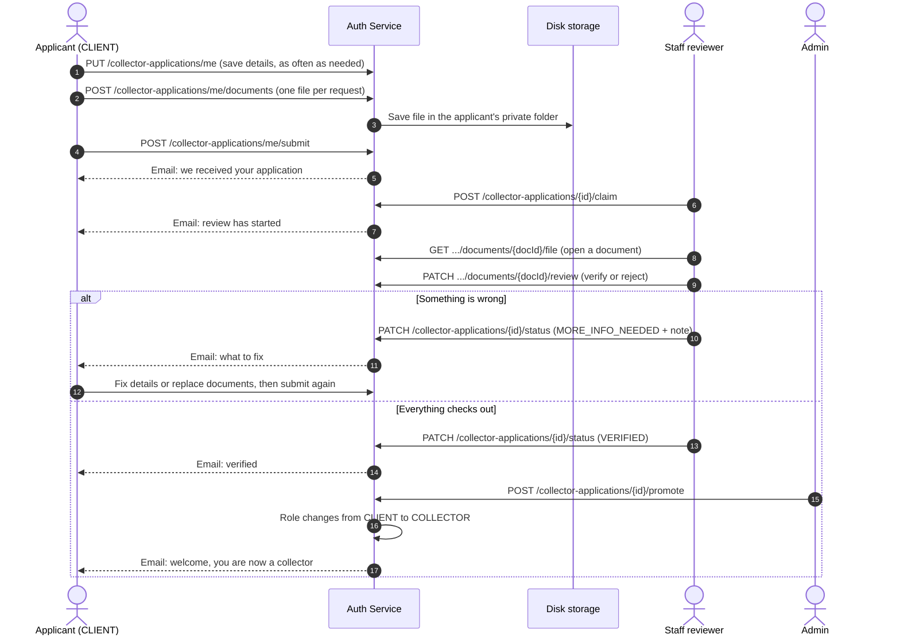
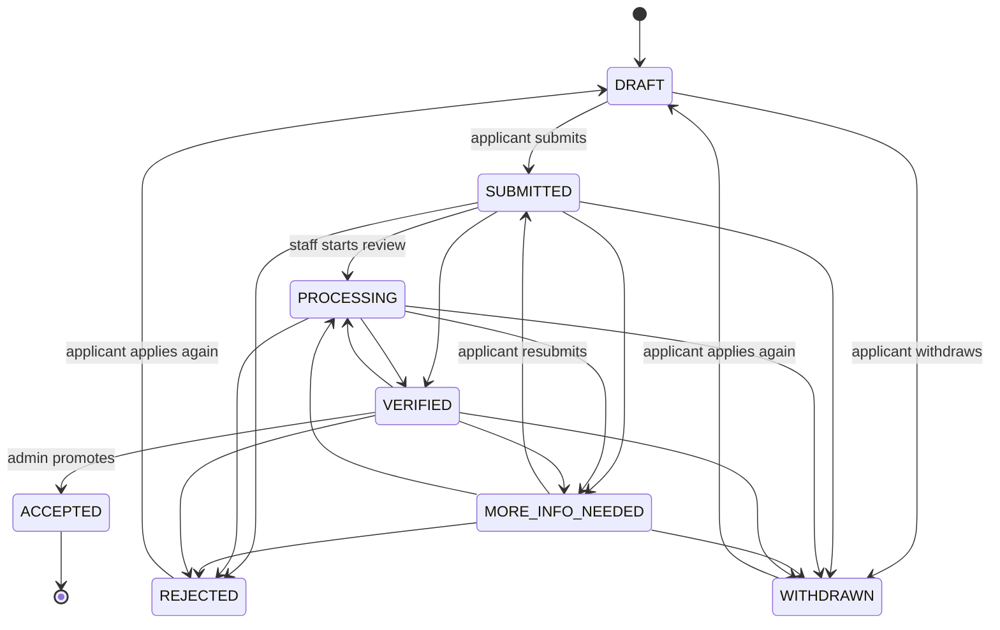

# Collector Applications

Customers who want to work as Garbigo collectors apply through the auth service. They fill in a profile, upload their documents, and submit. Staff review the application, verify each document, and an administrator promotes the applicant to a collector with one action. Every change the applicant should know about is emailed to them.

Documents (ID card or passport, driving licence, police clearance and so on) are saved as files in a private folder on the server's disk. They are never public. Staff open them through the service, which checks their role on every request.

## Contents

- [The journey](#the-journey)
- [Statuses](#statuses)
- [Who can do what](#who-can-do-what)
- [Required documents](#required-documents)
- [Application fields](#application-fields)
- [Applicant endpoints](#applicant-endpoints)
- [Staff endpoints](#staff-endpoints)
- [Postman quick start](#postman-quick-start)
- [Emails](#emails)
- [File storage setup](#file-storage-setup)
- [Configuration](#configuration)
- [Error messages](#error-messages)

## The journey



## Statuses



| Status | Label the applicant sees | Meaning | Applicant can edit |
|---|---|---|---|
| `DRAFT` | Draft | Saved but not submitted yet | Yes |
| `SUBMITTED` | Submitted | Waiting for a reviewer | No |
| `PROCESSING` | In review | A staff member is checking it | No |
| `MORE_INFO_NEEDED` | More information needed | Applicant must fix something and submit again | Yes |
| `VERIFIED` | Verified | Details and all required documents are verified. Waiting for the admin to promote | No |
| `ACCEPTED` | Accepted | Promoted. The account is now a `COLLECTOR` | No |
| `REJECTED` | Not approved | Closed. The applicant gets a list of corrections and can apply again (unless staff marked the decision final) | No |
| `WITHDRAWN` | Withdrawn | The applicant cancelled. They can start a new application | No |

Rules the service enforces:

- Staff cannot set `ACCEPTED` through the status endpoint. Only `POST /collector-applications/{id}/promote` does that, because it also changes the user's role.
- `REJECTED` and `MORE_INFO_NEEDED` need a note. The applicant sees it and it goes in the email. A rejection that allows reapplying must also list at least one correction (see "Rejection and applying again").
- `VERIFIED` is refused until every required document is verified and the applicant's details are complete. The response lists exactly what is still open.
- A person can have only one open application. After `REJECTED` or `WITHDRAWN` they can start a new one, subject to the reapply rules below.
- An ID number (same ID type and country) cannot be used in two live applications from different accounts.

## Rejection and applying again

When staff reject an application they send:

```json
{
    "status": "REJECTED",
    "note": "We could not verify your vehicle ownership.",
    "corrections": [
        "Upload a vehicle logbook that shows your name",
        "Use a driving licence that is valid for at least 6 months"
    ],
    "allowReapply": true
}
```

- `note` (required) is the reason. `corrections` is the list of things to fix. Documents already marked rejected are added to the list automatically. If `allowReapply` is true (the default) there must be at least one correction, so the applicant always knows what to change.
- Set `allowReapply` to `false` for a final decision. The applicant is told it is final and cannot start a new application. They are pointed to support.
- The applicant gets an email with the reason, a "What to correct" list and an "Apply again" button. The same list is on the application (`corrections`), in the timeline and on the staff view.

Applying again:

- `POST /collector-applications/me/reapply` starts a new draft from the latest `REJECTED` or `WITHDRAWN` application. Saving details with `PUT /collector-applications/me` does the same if no draft exists.
- The new application has a new reference number, `attemptNumber` goes up by one and `previousReferenceNumber` points to the old one.
- All details are copied (ID, address, vehicle, availability, payout, references and so on). The three declarations (terms, background check, information is true) are not copied and must be confirmed again.
- Documents that were verified and have not expired are copied, so the applicant uploads only what is missing or was rejected. Rejected or expired documents are not copied.
- The note and corrections from the rejection stay visible on the new draft until it is submitted.
- Settings: `COLLECTOR_APPLICATION_REAPPLY_COOLDOWN_DAYS` (days to wait after a rejection, default 0) and `COLLECTOR_APPLICATION_MAX_ATTEMPTS` (total applications per person, default 0 for no limit). When blocked, the response says why and, for a cooldown, `reapplyAvailableAt` has the date.

## Step by step tracking

Every step is added to the application's timeline, which both the applicant and staff can read. Each entry has a `type`, a `title`, an optional `note`, an `items` list and the time.

| Type | Examples |
|---|---|
| `STATUS` | Application submitted, Resubmitted with updates, Review started, More information requested, Details and documents verified, Application not approved, Approved and made a collector, Application withdrawn |
| `DETAILS` | Details updated (saves within 30 minutes are merged into one entry) |
| `DOCUMENT` | Document uploaded, replaced or removed, Verified documents carried over |
| `REVIEW` | Document verified, Document needs replacing (with the reviewer's note) |
| `ASSIGNMENT` | Assigned to a reviewer |
| `REAPPLY` | New application started (attempt 2) |
| `NOTE` | Internal note added. Staff only, never shown to the applicant, and the note text is not in the timeline |

Applicants see staff actions as "Garbigo team". Staff see the names.

## Who can do what

| Action | CLIENT (applicant) | SUPPORT, FINANCE, OPERATIONS | ADMIN |
|---|---|---|---|
| Fill in, upload, submit, withdraw their own application | Yes | No | No |
| List, search, and open applications | No | Yes | Yes |
| Claim an application, verify or reject documents, change status, add internal notes | No | Yes | Yes |
| Promote to collector | No | No | Yes |

Users who are already a `COLLECTOR`, and staff accounts, cannot apply. They get a friendly message instead.

## Required documents

Files must be PDF, JPG or PNG, up to 5 MB each. The service checks the real file content, not just the extension.

| Document type | Label | Required when |
|---|---|---|
| `ID_FRONT` | ID document (front, or the photo page of a passport) | Always |
| `ID_BACK` | ID document (back) | Unless the ID type is `PASSPORT` |
| `PASSPORT_PHOTO` | Passport-style photo (JPG or PNG only) | Always |
| `TAX_CERTIFICATE` | Tax registration document | Optional |
| `GOOD_CONDUCT_CERTIFICATE` | Police clearance certificate | Always |
| `DRIVING_LICENCE` | Driving licence | Vehicle is motorised |
| `VEHICLE_REGISTRATION` | Vehicle registration document | Vehicle is motorised |
| `INSURANCE_CERTIFICATE` | Vehicle insurance certificate | Vehicle is motorised |
| `WASTE_PERMIT` | Waste transport permit | Service includes `SEWAGE_EXHAUSTER` |
| `PROOF_OF_ADDRESS` | Proof of address | Optional |
| `OTHER` | Other supporting document | Optional, up to 5 |

Motorised vehicles are `MOTORBIKE`, `TUKTUK`, `PICKUP_TRUCK`, `LORRY` and `EXHAUSTER_TRUCK`. `HANDCART` is not motorised. Until a vehicle type is chosen, vehicle documents are shown as optional.

Uploading the same type again replaces the old file, unless that document is already verified. Verified documents cannot be replaced or deleted by the applicant.

## Application fields

Everything is optional while saving a draft. All of it (except references and the optional items) is needed to submit. `PUT /collector-applications/me` only changes the fields you send. Send `null` or leave a field out to keep it. Send an empty string to clear a text field.

| Field | Type | Notes |
|---|---|---|
| `countryCode` | string | Two-letter country code such as `KE`, `US` or `IN`. Get the full list from `/options`. Send this first, because phone numbers are read using it |
| `idType` | string | `NATIONAL_ID`, `PASSPORT`, `RESIDENCE_PERMIT` or `OTHER_GOVERNMENT_ID` |
| `idNumber` | string | The number exactly as printed on the document. Saved in upper case |
| `taxId` | string | Optional. Any tax number format |
| `dateOfBirth` | date | `yyyy-MM-dd`. Must be 18 or older |
| `alternatePhone` | string | Any valid number. Include the country code, or leave it out to use the country above. Saved as `+254712345678` |
| `region` | string | State, province, county or region. Optional |
| `city` | string | City or town |
| `postalCode` | string | Optional |
| `physicalAddress` | string | Up to 200 characters |
| `timeZone` | string | Optional. A time zone name such as `Africa/Nairobi` or `America/Chicago` |
| `serviceTypes` | array | `GENERAL_WASTE`, `RECYCLABLES`, `ORGANIC_WASTE`, `BULK_AND_CONSTRUCTION_WASTE`, `SEWAGE_EXHAUSTER` |
| `vehicleType` | string | `HANDCART`, `MOTORBIKE`, `TUKTUK`, `PICKUP_TRUCK`, `LORRY`, `EXHAUSTER_TRUCK` |
| `vehicleRegistration` | string | Required for motorised vehicles. The number plate as printed. Saved in upper case |
| `capacityValue`, `capacityUnit` | number, string | Unit is `KILOGRAMS`, `LITRES` or `CUBIC_METRES` |
| `serviceAreas` | array of string | Up to 10 areas |
| `maxTravelDistanceKm` | integer | 1 to 200 |
| `helpersCount` | integer | 0 to 20 |
| `availableDays` | array | `MONDAY` to `SUNDAY` |
| `shiftStart`, `shiftEnd` | string | `HH:mm`, for example `06:00` |
| `availableForEmergency` | boolean | Open to urgent pickups |
| `yearsOfExperience` | integer | 0 to 60. Enter 0 for new collectors |
| `experienceSummary` | string | Up to 1000 characters |
| `languages` | array of string | Up to 8 |
| `motivation` | string | Why they want to be a collector. Up to 1000 characters |
| `payoutMethod` | string | `MOBILE_MONEY`, `BANK_ACCOUNT` or `DIGITAL_WALLET` |
| `payoutProvider` | string | The bank, wallet or mobile money provider, for example `M-Pesa`, `Chase` or `PayPal` |
| `payoutAccountNumber` | string | Account number, or the phone number for mobile money (checked and saved in international format) |
| `payoutAccountName` | string | The name on the account |
| `emergencyContact` | object | `name`, `relationship`, `phone`. All three needed to submit |
| `references` | array | Up to 3 of `name`, `relationship`, `phone`. Optional |
| `acceptedTerms` | boolean | Must be `true` to submit |
| `consentToBackgroundCheck` | boolean | Must be `true` to submit |
| `confirmsInfoIsTrue` | boolean | Must be `true` to submit |

The response always includes a `progress` block with a percentage, a plain-language `missing` list, and per-section checks. It also has `nextSteps`, so a front end can show a checklist without any logic of its own.

## Applicant endpoints

All of these need `Authorization: Bearer <token>`.

| Method | Endpoint | Purpose |
|---|---|---|
| GET | `/collector-applications/options` | Countries with dialling codes, ID types, payout methods, vehicle types, service types, days, statuses, upload limits, baseline document list |
| GET | `/collector-applications/requirements?vehicleType=PICKUP_TRUCK&serviceTypes=SEWAGE_EXHAUSTER` | Documents needed for a given vehicle and services |
| GET | `/collector-applications/me` | The applicant's current application, or the invitation to start one |
| GET | `/collector-applications/me/history` | All their past applications |
| PUT | `/collector-applications/me` | Save details. Creates the draft on first call |
| POST | `/collector-applications/me/documents` | Upload one document (`multipart/form-data`) |
| DELETE | `/collector-applications/me/documents/{documentId}` | Remove a document |
| GET | `/collector-applications/me/documents/{documentId}/file` | Open their own uploaded file |
| POST | `/collector-applications/me/submit` | Submit, or resubmit after fixes |
| POST | `/collector-applications/me/withdraw` | Withdraw. Optional body `{ "reason": "..." }` |

### GET /collector-applications/me, before applying

```json
{
    "hasApplication": false,
    "canApply": true,
    "message": "Become a Garbigo collector. The application takes about 10 minutes, and you can save your progress and come back any time.",
    "application": null,
    "checklist": [
        {
            "type": "ID_FRONT",
            "label": "ID document (front)",
            "description": "The front of your ID card or residence permit, or the photo page of your passport.",
            "tip": "Place it on a flat, plain surface in good light. All four corners should be visible.",
            "required": true,
            "multiple": false,
            "acceptedFormats": "PDF, JPG or PNG",
            "maxFileSizeMb": 5,
            "uploaded": false,
            "reviewStatus": null
        }
    ]
}
```

### PUT /collector-applications/me

```json
{
    "countryCode": "KE",
    "idType": "NATIONAL_ID",
    "idNumber": "12345678",
    "taxId": "A123456789B",
    "dateOfBirth": "1994-03-21",
    "region": "Nairobi",
    "city": "Nairobi",
    "postalCode": "00100",
    "physicalAddress": "Pipeline Estate, Block C",
    "timeZone": "Africa/Nairobi",
    "serviceTypes": ["GENERAL_WASTE", "RECYCLABLES"],
    "vehicleType": "PICKUP_TRUCK",
    "vehicleRegistration": "KDA 123A",
    "capacityValue": 1200,
    "capacityUnit": "KILOGRAMS",
    "serviceAreas": ["Embakasi", "Donholm", "Umoja"],
    "maxTravelDistanceKm": 25,
    "helpersCount": 2,
    "availableDays": ["MONDAY", "TUESDAY", "WEDNESDAY", "THURSDAY", "FRIDAY", "SATURDAY"],
    "shiftStart": "06:00",
    "shiftEnd": "17:00",
    "availableForEmergency": true,
    "yearsOfExperience": 4,
    "experienceSummary": "Four years collecting household waste in Embakasi.",
    "languages": ["English", "Kiswahili"],
    "motivation": "I want a steady, formal way to grow my business.",
    "payoutMethod": "MOBILE_MONEY",
    "payoutProvider": "M-Pesa",
    "payoutAccountNumber": "0712345678",
    "payoutAccountName": "John Wanjiku",
    "emergencyContact": { "name": "Jane Wanjiku", "relationship": "Sister", "phone": "+254700111222" },
    "references": [
        { "name": "Peter Otieno", "relationship": "Estate chairman", "phone": "+254722333444" }
    ],
    "acceptedTerms": true,
    "consentToBackgroundCheck": true,
    "confirmsInfoIsTrue": true
}
```

Response (shortened):

```json
{
    "id": "6710f2c1a4b2c93d5e8f1a20",
    "referenceNumber": "GCA-2026-000001",
    "status": {
        "code": "DRAFT",
        "label": "Draft",
        "message": "Your application is saved but not sent yet. Finish the steps and submit it when you are ready."
    },
    "editable": true,
    "canSubmit": false,
    "canWithdraw": true,
    "lastNoteFromTeam": null,
    "nextSteps": [
        "Upload your ID document (front)",
        "Upload your ID document (back)",
        "Upload your Passport photo"
    ],
    "progress": {
        "percent": 67,
        "readyToSubmit": false,
        "missing": ["Upload your ID document (front)"],
        "sections": [
            { "name": "Personal details", "done": true },
            { "name": "Documents", "done": false }
        ]
    },
    "applicantName": "Bill Graham",
    "applicantEmail": "bill@example.com",
    "applicantPhone": "+254712345678",
    "details": { "idNumber": "12345678", "countryCode": "KE", "payoutAccountNumber": "+254712345678" },
    "requirements": [],
    "documents": [],
    "timeline": [
        { "status": "DRAFT", "title": "Application started", "note": null, "actorName": "You", "at": "2026-10-09T08:30:00Z" }
    ],
    "submittedAt": null,
    "updatedAt": "2026-10-09T08:31:12Z",
    "createdAt": "2026-10-09T08:30:00Z"
}
```

### POST /collector-applications/me/documents

`multipart/form-data` with these parts:

| Part | Required | Notes |
|---|---|---|
| `type` | Yes | A document type from the table above |
| `file` | Yes | PDF, JPG or PNG, up to 5 MB |
| `documentNumber` | No | For example the licence number |
| `expiryDate` | No | `yyyy-MM-dd`. Expired dates are refused |

The response is the full updated application, with the new document in `documents`:

```json
{
    "id": "0f4c1c6e-77a9-4d2f-b0c4-1c0f6e2f9a11",
    "type": "ID_FRONT",
    "typeLabel": "ID document (front)",
    "fileName": "id-front.jpg",
    "mimeType": "image/jpeg",
    "sizeBytes": 482113,
    "sizeLabel": "471 KB",
    "documentNumber": null,
    "expiryDate": null,
    "uploadedAt": "2026-10-09T08:35:10Z",
    "reviewStatus": "PENDING",
    "reviewStatusLabel": "Waiting for review",
    "reviewNote": null,
    "reviewedByName": null,
    "reviewedAt": null,
    "fileUrl": "/collector-applications/me/documents/0f4c1c6e-77a9-4d2f-b0c4-1c0f6e2f9a11/file"
}
```

### POST /collector-applications/me/submit

No body. If anything is missing the message names it:

```json
{ "message": "Almost there. Before you submit: Upload your Passport photo; Confirm that your information is true." }
```

### POST /collector-applications/me/reapply

No body. Starts a new application after a `REJECTED` or `WITHDRAWN` one, copies the details and the verified documents, and returns the new application with `attemptNumber`, `previousReferenceNumber` and the earlier `corrections`.

If it is not allowed the message says why:

```json
{ "message": "You can apply again in 5 days. Use the time to fix the points listed in our note." }
```

`GET /collector-applications/me` tells the app what to show: `canApply`, `message`, `reapplyAvailableAt` and `attempts`. The application itself carries `corrections`, `canReapply`, `reapplyAvailableAt`, `reapplyMessage` and the `timeline`.

## Staff endpoints

Roles `ADMIN`, `OPERATIONS`, `FINANCE` and `SUPPORT`. Promote is `ADMIN` only.

| Method | Endpoint | Purpose |
|---|---|---|
| GET | `/collector-applications` | Search and filter the queue |
| GET | `/collector-applications/stats` | Counts for a dashboard |
| GET | `/collector-applications/{id}` | Full application, with account, documents, timeline, internal notes |
| POST | `/collector-applications/{id}/claim` | Assign to me. Moves `SUBMITTED` to `PROCESSING` |
| PATCH | `/collector-applications/{id}/status` | Change status |
| PATCH | `/collector-applications/{id}/documents/{documentId}/review` | Verify or reject a document |
| GET | `/collector-applications/{id}/documents/{documentId}/file` | Open the uploaded file |
| POST | `/collector-applications/{id}/notes` | Add an internal note (never shown to the applicant) |
| POST | `/collector-applications/{id}/promote` | Make the applicant a collector (`ADMIN` only) |

### Search filters

`GET /collector-applications` accepts:

| Query parameter | Example | Notes |
|---|---|---|
| `q` | `wanjiku` | Matches name, email, phone, reference, ID number, tax ID |
| `status` | `SUBMITTED,PROCESSING` | One or more. Drafts are hidden unless you ask for `DRAFT` |
| `vehicleType` | `PICKUP_TRUCK` | |
| `country` | `KE` | Two-letter country code |
| `region` | `Nairobi` | State, province or region |
| `serviceType` | `SEWAGE_EXHAUSTER` | |
| `unassigned` | `true` | Applications nobody has claimed |
| `assignedTo` | `me` | Or a user id |
| `submittedFrom`, `submittedTo` | `2026-10-01` | Inclusive dates |
| `sortBy` | `submittedAt` | `createdAt`, `updatedAt`, `submittedAt`, `referenceNumber`, `status`, `applicantName` |
| `direction` | `asc` | `asc` or `desc`. Oldest first is useful for a queue |
| `page`, `size` | `0`, `20` | Size is capped at 100 |

Example: `GET /collector-applications?status=SUBMITTED&unassigned=true&sortBy=submittedAt&direction=asc`

```json
{
    "content": [
        {
            "id": "6710f2c1a4b2c93d5e8f1a20",
            "referenceNumber": "GCA-2026-000001",
            "status": { "code": "SUBMITTED", "label": "Submitted", "message": "We have received your application. A team member will start reviewing it soon." },
            "applicantName": "Bill Graham",
            "applicantEmail": "bill@example.com",
            "applicantPhone": "+254712345678",
            "maskedIdNumber": "12****78",
            "countryCode": "KE",
            "country": "Kenya",
            "region": "Nairobi",
            "city": "Nairobi",
            "vehicleType": "Pickup truck",
            "serviceTypes": ["Household and general waste", "Recyclables"],
            "documentsUploaded": 8,
            "documentsVerified": 0,
            "documentsRequired": 8,
            "completionPercent": 100,
            "assignedToName": null,
            "daysWaiting": 2,
            "submittedAt": "2026-10-07T09:12:00Z",
            "updatedAt": "2026-10-07T09:12:00Z"
        }
    ],
    "page": 0,
    "size": 20,
    "totalElements": 1,
    "totalPages": 1
}
```

ID numbers are masked in lists. The detail view shows them in full.

### GET /collector-applications/stats

```json
{
    "total": 42,
    "byStatus": { "DRAFT": 9, "SUBMITTED": 6, "PROCESSING": 4, "MORE_INFO_NEEDED": 3, "VERIFIED": 2, "ACCEPTED": 15, "REJECTED": 2, "WITHDRAWN": 1 },
    "awaitingReview": 6,
    "unassigned": 5,
    "submittedLast7Days": 8,
    "oldestWaitingDays": 3
}
```

`total` excludes drafts.

### GET /collector-applications/{id}

Adds the staff-only view on top of the applicant fields:

```json
{
    "id": "6710f2c1a4b2c93d5e8f1a20",
    "referenceNumber": "GCA-2026-000001",
    "status": { "code": "PROCESSING", "label": "In review", "message": "Our team is checking your details and documents right now." },
    "account": {
        "userId": "66f1...",
        "fullName": "Bill Graham",
        "email": "bill@example.com",
        "phoneNumber": "+254712345678",
        "role": "CLIENT",
        "profilePictureUrl": "https://res.cloudinary.com/...",
        "accountActive": true
    },
    "details": { },
    "progress": { "percent": 100, "readyToSubmit": true, "missing": [], "sections": [] },
    "requirements": [],
    "documents": [
        {
            "id": "0f4c1c6e-77a9-4d2f-b0c4-1c0f6e2f9a11",
            "type": "ID_FRONT",
            "typeLabel": "ID document (front)",
            "reviewStatus": "PENDING",
            "fileUrl": "/collector-applications/6710f2c1a4b2c93d5e8f1a20/documents/0f4c1c6e-77a9-4d2f-b0c4-1c0f6e2f9a11/file"
        }
    ],
    "allRequiredDocumentsVerified": false,
    "blockers": ["ID document (front) is waiting for review"],
    "allowedNextStatuses": [
        { "code": "MORE_INFO_NEEDED", "label": "More information needed" },
        { "code": "VERIFIED", "label": "Verified" },
        { "code": "REJECTED", "label": "Not approved" }
    ],
    "canPromote": false,
    "assignedToId": "66a0...",
    "assignedToName": "Mary Achieng",
    "timeline": [],
    "internalNotes": [],
    "submissionCount": 1,
    "submittedAt": "2026-10-07T09:12:00Z",
    "decidedAt": null,
    "updatedAt": "2026-10-09T07:50:00Z",
    "createdAt": "2026-10-07T08:40:00Z"
}
```

`allowedNextStatuses`, `blockers` and `canPromote` are there so a front end can enable or disable its buttons without duplicating rules. `canPromote` is `true` only when the application is `VERIFIED` and the viewer is an `ADMIN`.

### PATCH /collector-applications/{id}/status

```json
{
    "status": "MORE_INFO_NEEDED",
    "note": "The back of your ID is blurry. Please upload a clearer photo and submit again.",
    "internalNote": "Second time this applicant has uploaded a blurry ID."
}
```

`note` is shown to the applicant and emailed. `internalNote` is optional and staff-only. `MORE_INFO_NEEDED` and `REJECTED` require a `note`. Both also take an optional `corrections` list (up to 10 short items). Rejected documents are added to the list automatically, and the list is shown in the email, on the application and in the timeline. For `REJECTED`, `allowReapply` (default true) decides whether the applicant may apply again; when true at least one correction is required. The response is the full staff view.

### PATCH /collector-applications/{id}/documents/{documentId}/review

```json
{ "status": "REJECTED", "note": "The photo is cut off at the bottom. Please include the whole card." }
```

`status` is `VERIFIED`, `REJECTED` or `PENDING` (to undo a review). Rejecting needs a note. The first review of a `SUBMITTED` application starts the review automatically: the status becomes `PROCESSING`, it is assigned to the reviewer, and the applicant is emailed. If the application is already `MORE_INFO_NEEDED` and a new document is rejected, the applicant gets an email about that document.

### POST /collector-applications/{id}/promote

The button. Body is optional:

```json
{ "note": "Welcome to the team. Please keep your live location on while you work." }
```

What happens, all in one request:

1. The application must be `VERIFIED`. Otherwise the message says to verify it first.
2. The applicant's `role` changes from `CLIENT` to `COLLECTOR`.
3. The application becomes `ACCEPTED` and the decision time is recorded.
4. A timeline entry records who approved it.
5. The applicant is emailed.

It is refused if the account is already a collector, is a staff account, or is deactivated or archived.

### POST /collector-applications/{id}/notes

```json
{ "note": "Called the reference, Peter Otieno confirms the applicant. All good." }
```

## Postman quick start

Create these collection variables: `base_url` (for example `http://localhost:8080`), `token`, `application_id`, `document_id`.

**Applicant**

1. `POST {{base_url}}/auth/signin` and copy the token into `token`.
2. `GET {{base_url}}/collector-applications/options`
3. `PUT {{base_url}}/collector-applications/me` with the JSON above.
4. `POST {{base_url}}/collector-applications/me/documents`. Body type `form-data`: `type` (Text) = `ID_FRONT`, `file` (File) = your image. Repeat for each document.
5. `GET {{base_url}}/collector-applications/me` and check `progress` and `nextSteps`.
6. `POST {{base_url}}/collector-applications/me/submit`

**Staff** (sign in as a user whose role is `SUPPORT`, `FINANCE`, `OPERATIONS` or `ADMIN`)

1. `GET {{base_url}}/collector-applications?status=SUBMITTED`. Copy an `id` into `application_id`.
2. `POST {{base_url}}/collector-applications/{{application_id}}/claim`
3. `GET {{base_url}}/collector-applications/{{application_id}}`. Copy a document `id` into `document_id`.
4. `GET {{base_url}}/collector-applications/{{application_id}}/documents/{{document_id}}/file`. In Postman use Send and Download to see the file.
5. `PATCH {{base_url}}/collector-applications/{{application_id}}/documents/{{document_id}}/review` with `{ "status": "VERIFIED" }`. Repeat for each required document.
6. `PATCH {{base_url}}/collector-applications/{{application_id}}/status` with `{ "status": "VERIFIED" }`
7. As an `ADMIN`: `POST {{base_url}}/collector-applications/{{application_id}}/promote`

## Emails

The applicant is emailed when:

| Event | Sent to | Subject |
|---|---|---|
| They submit or resubmit | Applicant | We received your collector application |
| A resubmission after a request for changes | The assigned reviewer | Application GCA-... was resubmitted |
| A reviewer starts (claim, or first document review) | Applicant | Your collector application is being reviewed |
| Status becomes `MORE_INFO_NEEDED` | Applicant | Action needed on your collector application (with a "What to fix" list) |
| A document is rejected while the application is `MORE_INFO_NEEDED` | Applicant | A document on your collector application needs replacing |
| Status becomes `VERIFIED` | Applicant | Your collector application is verified |
| They are promoted | Applicant | Welcome aboard, you are now a Garbigo collector |
| Status becomes `REJECTED` | Applicant | Your collector application was not approved: what to correct (reason, corrections and an "Apply again" button, or a final decision notice) |
| They start a new application | Applicant | Your new collector application has started |
| They withdraw | Applicant | Your collector application was withdrawn |

Emails use the template `emails/application-update.html`. Each one shows the reference number, current status, the team's note, a short "What happens next" list, and a button back to the application. Emails are sent in the background, so a mail problem never blocks or rolls back a review.

Document rejections that happen before the application is moved to `MORE_INFO_NEEDED` are not emailed one by one. They are listed together in the `MORE_INFO_NEEDED` email, so the applicant gets one clear message instead of several.

## File storage setup

Documents are written as files. `STORAGE_MODE` in `.env` chooses where, and a restart applies the change:

| Mode | Where documents go | Settings it needs |
|---|---|---|
| `LOCAL` (default) | A folder on the machine that runs the service, or any path the service user can write to | `STORAGE_ROOT` |
| `NETWORK` | A NAS share (SMB or NFS, for example a Synology) that is already mounted on the server | `STORAGE_NETWORK_MOUNT_PATH`, and `STORAGE_NETWORK_HOST`, `STORAGE_NETWORK_SHARE` for the mount check |

There is no default location in either mode. If the chosen mode is not set up (for example `STORAGE_ROOT` is empty in LOCAL mode, or `STORAGE_NETWORK_MOUNT_PATH` is empty in NETWORK mode), the service still starts and everything else works, but uploads and document views return the friendly "document storage" message and the log says what is missing. A wrong `STORAGE_MODE`, protocol or directory is reported the same way, and nothing is saved anywhere by guesswork.

### Local folder

```
STORAGE_MODE=LOCAL
STORAGE_ROOT=/home/graham218/MyProjects/file-storage/Garbigo-Auth/
```

### Network share

Mount the share on the server first. The service never connects to the NAS and never mounts anything itself. It only reads the server's list of mounted drives to confirm that the right share is mounted at the mount path.

```
STORAGE_MODE=NETWORK
STORAGE_NETWORK_PROTOCOL=SMB
STORAGE_NETWORK_HOST=192.168.1.20
STORAGE_NETWORK_SHARE=garbigo
STORAGE_NETWORK_MOUNT_PATH=/mnt/garbigo-nas
STORAGE_NETWORK_DIRECTORY=garbigo-auth
STORAGE_NETWORK_REQUIRE_MOUNT=true
```

- For SMB, the share is the share name. For NFS, set `STORAGE_NETWORK_PROTOCOL=NFS` and the share is the exported path, for example `/volume1/garbigo`.
- Documents are saved in `STORAGE_NETWORK_DIRECTORY` inside the share. An empty value saves them at the top of the share.
- The host must be written the way it was mounted. If the share was mounted by IP address, use the IP address here, not the host name. Share names are compared without case for SMB and exactly for NFS.
- With `STORAGE_NETWORK_REQUIRE_MOUNT=true` the service checks the mount when it starts and again before every upload, download and delete. If the share is missing, belongs to another host or share, or something else (such as a local disk) is mounted at the path, the request is refused and the log says why. This stops files from silently landing on the local disk when the NAS is offline. Uploads work again as soon as the share is back, with no restart.
- With `STORAGE_NETWORK_REQUIRE_MOUNT=false` there is no check and the folder is created if it does not exist. Use it only for development.
- The mount check reads `/proc/self/mountinfo`, so it works on Linux only. On Windows or macOS use `STORAGE_MODE=LOCAL`, or set `STORAGE_NETWORK_REQUIRE_MOUNT=false`.
- To make a mount survive restarts, add it to `/etc/fstab` on the server, for example `//192.168.1.20/garbigo /mnt/garbigo-nas cifs credentials=/etc/garbigo-nas.cred,uid=graham218,gid=graham218,_netdev,nofail 0 0`. The credentials file belongs to the server, not to this project, and should be readable by root only.

### Switching between modes

The database stores the path of each file inside the storage folder, so a document is found in either mode as long as the files are in the same relative place. Switching does not move any files. To switch:

1. Stop the service.
2. Copy the contents of the current storage folder into the new one, keeping the structure (`collector-applications/...`). For example, from the local folder into the mounted share's directory: `cp -a /home/graham218/MyProjects/file-storage/Garbigo-Auth/. /mnt/garbigo-nas/garbigo-auth/`.
3. Change `STORAGE_MODE` and its settings in `.env`, then start the service.
4. Check the log for the `STORAGE:` line, then open one document as staff to confirm.

If you skip the copy, existing applications show "This file could not be found" until the files are back, and new uploads are saved in the new place. Switching back and copying again restores them.

Inside the storage folder the service creates:

```
collector-applications/
    GCA-2026-000001 - Bill Graham/
        PASSPORT_3f9a12bc.pdf
        DRIVING_LICENCE_77d0e4a1.jpg
```

Setup:

1. Create the folder, or let the service create it on start, and make sure the user that runs the service owns it and can read and write there.
2. For a Synology or other NAS, mount the share on the server first (NFS or SMB) and use NETWORK mode. The share must stay mounted whenever the service runs, otherwise uploads fail with the "document storage" message.
3. Set the storage settings in `.env`, then restart the service. The log shows `STORAGE: documents are stored in ...` (LOCAL) or `STORAGE: documents are stored on the SMB share mounted at ...` (NETWORK) on start, or an error saying what is wrong.

Keep in mind:

- The files are ID documents and certificates, which are personal data. Put the folder on an encrypted disk or share if you can, limit who has access to the server and the NAS, and decide how long you keep documents of rejected or withdrawn applications. Data protection laws such as the Data Protection Act in Kenya, the GDPR in Europe, or similar laws where your applicants live may apply, so check your obligations.
- Never put the folder inside a directory that a web server or file browser exposes. Files are only served through the service, after a role check, and each staff view is written to the service log with the staff member's id.
- By default new folders and files are readable only by the user running the service (`STORAGE_RESTRICT_PERMISSIONS=true`). Turn that off if your backup tool or NAS needs group access.
- Back the folder up. The database stores only the path of each file, so a lost file cannot be rebuilt from the database.
- Do not rename or delete files by hand. The database stores each file's path inside the storage folder, so you can move the whole folder to another disk or share and change the settings, but renaming a single file breaks that document.
- Documents uploaded when the service still used Google Drive are not found on disk. Ask those applicants to upload them again, or copy the files into the new folder structure and update their `storageFile` values.
- The service refuses any path that would leave the storage root, and file names are generated by the service, never taken from the upload.

## Configuration

Add to `.env` (`STORAGE_ROOT` is required in LOCAL mode, `STORAGE_NETWORK_MOUNT_PATH` in NETWORK mode, and the rest are optional with the defaults shown):

```properties
STORAGE_MODE=LOCAL
STORAGE_ROOT=/path/to/your/storage/folder/
STORAGE_NETWORK_PROTOCOL=SMB
STORAGE_NETWORK_HOST=
STORAGE_NETWORK_SHARE=
STORAGE_NETWORK_MOUNT_PATH=
STORAGE_NETWORK_DIRECTORY=garbigo-auth
STORAGE_NETWORK_REQUIRE_MOUNT=true
STORAGE_APPLICATIONS_FOLDER=collector-applications
STORAGE_RESTRICT_PERMISSIONS=true
COLLECTOR_APPLICATION_MAX_FILE_MB=5
COLLECTOR_APPLICATION_REVIEW_DAYS=3
COLLECTOR_APPLICATION_PAGE_PATH=/collector/application
COLLECTOR_APPLICATION_STAFF_PAGE_PATH=/admin/collector-applications
COLLECTOR_APPLICATION_REAPPLY_COOLDOWN_DAYS=0
COLLECTOR_APPLICATION_MAX_ATTEMPTS=0
```

| Variable | Purpose |
|---|---|
| `STORAGE_MODE` | `LOCAL` (default) or `NETWORK`. Chooses where documents are saved |
| `STORAGE_ROOT` | LOCAL mode. Required, no default. Folder where documents are saved. Created if missing |
| `STORAGE_NETWORK_PROTOCOL` | NETWORK mode. `SMB` (default) or `NFS` |
| `STORAGE_NETWORK_HOST` | NETWORK mode. IP address or name of the NAS, as it was mounted. Only used to check the mount |
| `STORAGE_NETWORK_SHARE` | NETWORK mode. SMB share name, or the NFS exported path. Only used to check the mount |
| `STORAGE_NETWORK_MOUNT_PATH` | NETWORK mode. Required, no default. Folder where the share is mounted on the server |
| `STORAGE_NETWORK_DIRECTORY` | NETWORK mode. Folder inside the share that holds the documents. Default `garbigo-auth` |
| `STORAGE_NETWORK_REQUIRE_MOUNT` | NETWORK mode. When true, reads and writes are refused unless the share is really mounted. Default true |
| `STORAGE_APPLICATIONS_FOLDER` | Sub folder of the root that holds one folder per application |
| `STORAGE_RESTRICT_PERMISSIONS` | Owner-only permissions on new folders and files |
| `COLLECTOR_APPLICATION_MAX_FILE_MB` | Per-file upload limit. Keep it at or below the `spring.servlet.multipart` limit (10 MB) |
| `COLLECTOR_APPLICATION_REVIEW_DAYS` | The "we usually reply within N working days" text in emails and next steps |
| `COLLECTOR_APPLICATION_PAGE_PATH` | Front-end route the email button opens, added to `APP_URL` |
| `COLLECTOR_APPLICATION_STAFF_PAGE_PATH` | Front-end route staff open from the resubmission email. The application id is added at the end |
| `COLLECTOR_APPLICATION_REAPPLY_COOLDOWN_DAYS` | Days a rejected applicant waits before applying again. 0 means no wait |
| `COLLECTOR_APPLICATION_MAX_ATTEMPTS` | Most applications one person may make in total. 0 means no limit |

The Google Drive libraries are no longer needed. The email template is `src/main/resources/templates/emails/application-update.html`.

## Error messages

Every error has the same shape as the rest of the API and is written for the applicant, not a developer:

```json
{ "message": "Please upload a PDF, JPG or PNG file. If your phone saved the photo in HEIC format, change the camera setting to 'Most compatible' and take the photo again." }
```

| Situation | Message |
|---|---|
| Wrong file type | Please upload a PDF, JPG or PNG file. If your phone saved the photo in HEIC format, change the camera setting to 'Most compatible' and take the photo again. |
| File too large | That file is too large. Please upload a file smaller than 5 MB. |
| Editing after submitting | Your application is with our team, so it can't be edited right now. If we need anything, we will email you. You can also withdraw it and start again. |
| Submitting with gaps | Almost there. Before you submit: Upload your Passport photo; Accept the terms and conditions. |
| Under 18 | You must be at least 18 years old to apply. |
| Already a collector | Your account is already a collector account. You do not need to apply again. |
| Rejecting without a reason | Please tell the applicant why the application is not approved (at least a short sentence). They will see this note. |
| Verifying too early | Verify every required document first. Still open: ID document (front) is waiting for review. |
| Promoting too early | Verify the application first. Move it to Verified once every document has been checked, then try again. |
| Storage problem | We couldn't reach document storage right now. Please try again in a few minutes. |